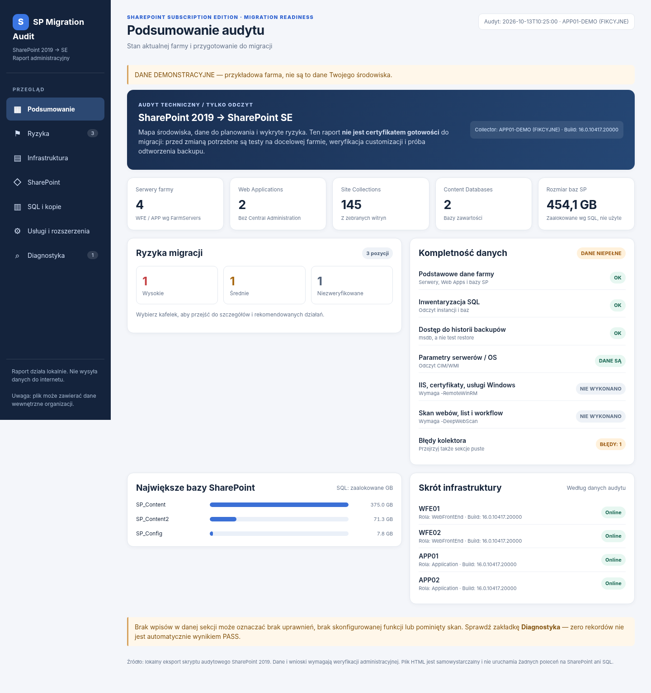

# SP — SharePoint 2019 → SharePoint Subscription Edition

Zestaw narzędzi **PowerShell 5.1** do inwentaryzacji istniejącej farmy SharePoint Server 2019 przed migracją typu *database attach* do SharePoint Server Subscription Edition (SE).

> **Uwaga:** narzędzie ma charakter diagnostyczny. Wynik audytu ani wskaźnik *readiness* nie stanowią potwierdzenia gotowości do migracji. Skrypty nie były przetestowane na rzeczywistej farmie produkcyjnej. Uruchom najpierw w ograniczonym zakresie i oceń `CollectionErrors.csv`.

## Wersje

| Wersja | Katalog | Zawartość |
|---|---|---|
| **v1.0** | [`v1/`](v1/) | Pierwotny kolektor PowerShell, raporty CSV/JSON, podstawowy HTML. |
| **v2.0** | [`v2/`](v2/) | Pierwszy interaktywny dashboard HTML offline; wersja archiwalna. |
| **v2.1** | [`v2.1/`](v2.1/) | Naprawiony eksport HTML, automatyczne wykrywanie przebiegu, odzyskiwanie z CSV. |
| **v2.2** | [`v2.2/`](v2.2/) | Pełny audyt farmy i nocne uruchomienie w Harmonogramie. |
| **v2.3** | [`v2.3/`](v2.3/) | **Nowe.** Lokalny audyt SQL i scalanie ze SharePoint do HTML/MD. |



Wersje pozostają **oddzielne i nie są nadpisywane**. **Używaj `v2.2` do pełnego skanu SharePoint, a `v2.3` do lokalnego SQL i scalania wyników**. Starsze wersje pozostają jako historia.

## Szybki start — v2.2

Skopiuj cztery pliki z [`v2.2/`](v2.2/) do jednego katalogu na serwerze APP/WFE SharePoint 2019:

- `Invoke-SP2019ReadinessAudit.ps1`
- `New-SPSEDashboard.ps1`
- `New-SPSEShareableAudit.ps1`
- `dashboard_template.html`

Uruchom **Windows PowerShell 5.1 (x64)** z uprawnieniami do farmy SharePoint (i odpowiednimi prawami odczytu SQL):

```powershell
Set-ExecutionPolicy -Scope Process -ExecutionPolicy Bypass -Force
& "C:\Scripts\SPSEAudit\v2.2\Invoke-SP2019ReadinessAudit.ps1" -OutputRoot "C:\SP_Audit"
```

Następnie otwórz `SPSE_Readiness_Report.html` z katalogu przebiegu. Więcej szczegółów: [`v2.2/README.md`](v2.2/README.md).

**Odtworzenie dashboardu z istniejącego audytu**, bez ponownego skanowania farmy:

```powershell
& "C:\Scripts\SPSEAudit\v2.2\New-SPSEDashboard.ps1" -InputPath "C:\SP_Audit"
```


**Raport do udostępnienia z już wykonanego audytu (bez ponownego skanowania):**

```powershell
& "C:\Scripts\SPSEAudit\v2.2\New-SPSEShareableAudit.ps1" -InputPath "C:\SP_Audit"
```

Skrypt tworzy **jeden plik Markdown** z aliasami zamiast identyfikatorów infrastruktury. To pseudonimizacja, nie gwarancja anonimowości: przejrzyj wynik przed wysłaniem. Nie udostępniaj JSON/CSV/HTML z produkcji. Więcej: [`v2.2/README.md`](v2.2/README.md).

## Pełny nocny audyt w Harmonogramie zadań (v2.2.1)

Gotowy launcher i instalator jednorazowego zadania na najbliższą 22:00 czasu serwera:

- [Run-SPAudit-Night.ps1](v2.2/scheduler/Run-SPAudit-Night.ps1) — pełny audyt, lokalny log, kontrola HTML/MD/JSON.
- [Register-SPAuditTask.ps1](v2.2/scheduler/Register-SPAuditTask.ps1) — rejestracja zadania Windows Task Scheduler.
- [Instrukcja offline](v2.2/scheduler/README.md) — kompletna struktura plików i weryfikacja rano.

Po rozpakowaniu folderu v2.2 na serwerze APP:

    & "C:\temp\sprawdzenie\v22\scheduler\Register-SPAuditTask.ps1"

Instalator poprosi lokalnie o konto i hasło. Wyniki audytu nie są publikowane na GitHubie.

## v2.3 — audyt SQL lokalnie i scalanie raportów

Jeśli zdalny audyt SQL z serwera APP kończy się błędem RPC/WinRM/SSL handshake, **nie trzeba ponownie skanować całej farmy**.

- [Katalog v2.3](v2.3/) — lokalny kolektor SQL Server i generator scalonego HTML/MD.
- [Instrukcja v2.3](v2.3/README.md) — wykonanie osobno na SQL i APP.
- [Test z fikcyjnymi danymi](tests/Test-SPSESqlMerge.ps1) — regresja łączenia SQL/SharePoint bez dostępu do produkcji.

Pełny audyt SharePoint i lokalny SQL są źródłami; pliki bazowe nie są nadpisywane.

## Bezpieczeństwo i ograniczenia

- **Nie publikuj wyników audytu** (`FullInventory.json`, CSV, raportów HTML z produkcji, ZIP-ów wynikowych). Mogą zawierać nazwy serwerów, kont, adresy wewnętrzne, ścieżki oraz wpisy diagnostyczne.
- W repozytorium jest tylko **przykładowy, fikcyjny** raport HTML (`v2/PRZYKLAD_DASHBOARD_DEMO.html`).
- Skrypty wykonują odczyt danych farmy i zapisują raporty lokalnie; opcjonalne głębokie skanowanie witryn może obciążyć produkcję.
- SQL, WinRM, WMI/CIM oraz poszczególne komponenty SharePoint wymagają stosownych uprawnień. Brak wyniku nie jest potwierdzeniem braku problemu.
- Przed migracją niezależnie zweryfikuj wspieraną ścieżkę upgrade'u, aktualne wymagania środowiska docelowego, test odtworzenia backupów, niestandardowe rozwiązania oraz procedurę rollback.

## Struktura projektu

```text
SP/
├── README.md
├── CHANGELOG.md
├── .gitignore
├── v1/
│   ├── Invoke-SP2019ReadinessAudit.ps1
│   └── README_START_HERE.txt
└── v2/
    ├── Invoke-SP2019ReadinessAudit.ps1
    ├── New-SPSEDashboard.ps1
    ├── dashboard_template.html
    ├── PRZYKLAD_DASHBOARD_DEMO.html
    ├── README_START_HERE.txt
    └── docs/dashboard_preview.png
└── v2.1/
    ├── Invoke-SP2019ReadinessAudit.ps1
    ├── New-SPSEDashboard.ps1
    ├── dashboard_template.html
    ├── README.md
    └── tests/Test-Dashboard.ps1
```

Repozytorium publiczne nie oznacza automatycznie udzielenia licencji open-source. Licencję można dobrać później, jeśli projekt ma umożliwiać dalsze wykorzystanie przez innych.
